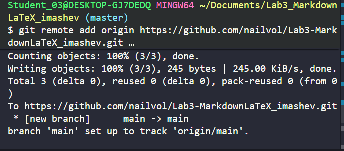

# Лабораторная работа №3. Работа с Markdown-разметкой и базовое использование LaTeX в документации проекта

Данный проект выполнен в рамках изучения базовых и расширенных возможностей языка разметки **Markdown**, а также интеграции математических формул **LaTeX** в техническую документацию. Целью работы является освоение навыков оформления репозиториев на GitHub, структурирования отчётов и создания наглядных `README`-файлов[^1]. В ходе выполнения лабораторной работы были отработаны базовые команды системы контроля версий Git.

---

## Содержание (Table of Contents)

1. [Структура проекта](#структура-проекта)
2. [Демонстрация возможностей Markdown](#демонстрация-возможностей-markdown)
   - [Форматирование текста и цитаты](#форматирование-текста-и-цитаты)
   - [Примеры кода и таблиц](#примеры-кода-и-таблиц)
   - [Чекбоксы и Alert-блоки](#чекбоксы-и-alert-блоки)
3. [Использование LaTeX](#использование-latex)
4. [Скриншот выполнения](#скриншот-выполнения)

---

## Структура проекта

Ниже представлена актуальная файловая иерархия репозитория:

* `README.md` — главный файл документации проекта
* `docs/` — папка с учебными Markdown-файлами:
  * `ReadmePushLab3_imashev.md` — описание первого пуша
  * `headersLab3_imashev.md` — примеры заголовков H1–H4
  * `separatorsLab3_imashev.md` — работа с горизонтальными разделителями
  * `formattingLab3_imashev.md` — текстовое форматирование
  * `listsLab3_imashev.md` — маркированные, нумерованные и вложенные списки
  * `linksImagesLab3_imashev.md` — работа со ссылками и локальными изображениями
  * `codeQuotesLab3_imashev.md` — блоки кода и цитирование
  * `tablesLab3_imashev.md` — таблицы и выравнивание столбцов
  * `advancedMarkdownLab3_imashev.md` — чекбоксы, сноски, alerts, escape-символы и HTML
  * `latexLab3_imashev.md` — математические формулы LaTeX
* `img/` — каталог со скриншотами коммитов и работы в терминале Git Bash

---

## Демонстрация возможностей Markdown

### Форматирование текста и цитаты

В документации можно использовать **полужирный текст**, *курсив*, ~~зачёркнутый текст~~ для устаревших данных и `моноширный шрифт` для обозначения команд и имён файлов. Подробнее о синтаксисе можно прочитать на официальном сайте [Markdown Guide](https://markdownguide.org).

> Хорошая документация делает проект понятным для других разработчиков и упрощает его дальнейшую поддержку.

### Примеры кода и таблиц

Пример блока кода на языке **C#** с подсветкой синтаксиса:

```csharp
using System;

class Program
{
    static void Main()
    {
        Console.WriteLine("Лабораторная работа №3 успешно выполнена!");
    }
}
```

Основные команды Git, использованные в ходе работы:

| Этап работы | Команда Git | Назначение |
|:---|:---:|---:|
| Инициализация | `git init` | Создание локального репозитория |
| Индексация | `git add .` | Добавление всех файлов в индекс |
| Фиксация | `git commit -m "..."` | Сохранение изменений в истории |
| Публикация | `git push` | Отправка коммитов на сервер GitHub |

### Чекбоксы и Alert-блоки

Список выполненных этапов лабораторной работы:

- [x] Настроить рабочую директорию и связать локальный репозиторий с GitHub
- [x] Создать и заполнить все практические файлы в папке `docs/`
- [ ] Сделать финальный коммит и скриншот `readmeFinalPushLab3_imashev.png`

> [!NOTE]
> Вся документация в этом репозитории автоматически рендерится веб-интерфейсом GitHub.

> [!TIP]
> Используйте сочетание клавиш `Ctrl + Shift + V` в VS Code для быстрого предпросмотра Markdown-файлов.

> [!WARNING]
> При вставке изображений из папки `img/` в корневой файл `README.md` путь начинается с `./img/`, а для файлов внутри `docs/` — с `../img/`.

---

## Использование LaTeX

Markdown на GitHub поддерживает отображение математических формул. Например, строчная (inline) формула площади круга выглядит так: $S = \pi r^2$.

Блочная формула суммы арифметической прогрессии:

$$
\sum_{i=1}^n i = \frac{n(n+1)}{2}
$$

---

## Скриншот выполнения

Пример фиксации и отправки файлов на удалённый репозиторий:



[^1]: Файл `README.md` является визитной карточкой любого репозитория на GitHub и отображается на его главной странице.
